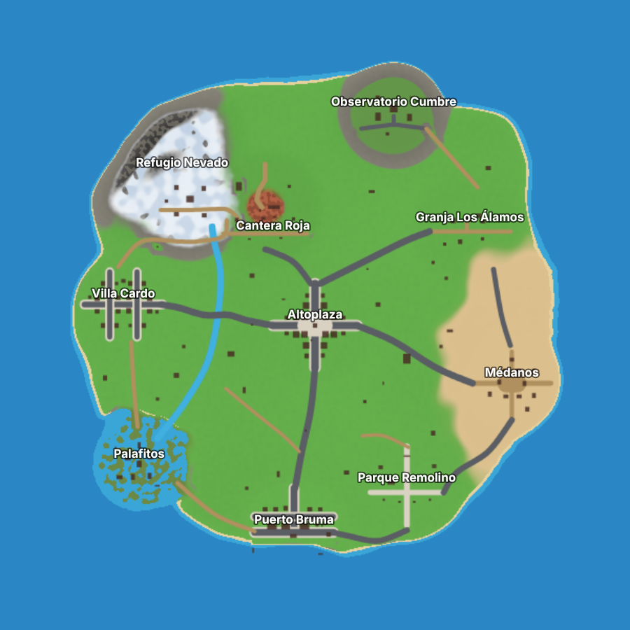

# Salto Final

Battle royale 3D para navegador: una isla con 10 pueblos distintos, bus volador, caída libre con planeador, tormenta que se achica y salas privadas a las que se entra con un código.

## Cómo jugar en tu compu

```bash
npm install
npm start
```

Abrí http://localhost:3000, poné tu nombre y tocá **Crear sala**. Tus amigos entran con el código de 5 letras (o con el link `http://TU-IP:3000/?sala=CODIGO` si están en tu misma red). Para jugar por internet hay que subir el servidor a un hosting con Node y WebSockets (Render, Railway, Fly.io, etc.).

## El mapa

Una isla fija de 1200 × 1200 m, la misma en todas las partidas, con todas las estructuras y el terreno modelados en 3D:

| Pueblo | Cómo es |
|---|---|
| **Altoplaza** (centro) | Ciudad con edificios de varios pisos, locales con toldo, plaza con fuente y veredas |
| **Villa Cardo** (oeste) | Barrio de casas con jardín, cercas y cobertizos |
| **Puerto Bruma** (sur) | Malecón, galpones, contenedores, grúa, muelles, botes y faro |
| **Granja Los Álamos** (este) | Granero con altillo, silos, molino, tanque de agua y campos sembrados |
| **Médanos** (este, desierto) | Casas de adobe con terraza y mercado |
| **Parque Remolino** (sureste) | Rueda de la fortuna, calesita, montaña rusa y kioscos |
| **Palafitos** (suroeste) | Casas sobre pilotes en la ciénaga, unidas por pasarelas |
| **Cantera Roja** (noroeste) | Pozo escalonado de roca roja con tolva, andamio y contenedores |
| **Refugio Nevado** (montaña) | Lodge y cabañas en la nieve, con teleférico hasta la cumbre |
| **Observatorio Cumbre** (norte) | Cúpula con telescopio, laboratorios y antena sobre un cerro |

Entre los pueblos hay rutas con postes de luz, caminos de tierra, un río con puentes, indicadores de caminos y más de 40 lugares chicos con un poco de loot (estación de servicio, torres de vigía, capilla en ruinas, camping, cobertizos, ruinas...). El agua tiene olas, cambia de color con la profundidad y hace espuma en la orilla.

**Todo se rompe.** Cada estructura del mapa está armada en piezas (tramos de pared, baldosas de piso, aguas del techo, escaleras, muebles, tramos de muelle y de puente) que se rompen con el pico, a tiros y con explosiones. Cada pieza es de madera, piedra o metal y su vida depende del material y del tamaño. Cuando se rompe lo que sostiene algo, lo que queda en el aire se cae, y el loot y los cofres que estaban encima bajan al piso nuevo. Los cimientos, el malecón, los postes de luz, los carteles y las torres del teleférico no se rompen.

Sin errores de colisión: las puertas quedan al ras del piso, no se atraviesan techos ni pisos aunque se caiga rápido, todas las escaleras se suben (con baranda sólida), las ventanas tienen vidrio que frena al jugador pero deja pasar las balas, los puentes siguen la pendiente de las dos orillas y todo el loot se alcanza caminando. Lo revisan las pruebas automáticas:

```bash
node tools/mapa/pruebas.mjs
```

Además de las colisiones, las pruebas revisan lo que se ve: caras al revés, partes que se atraviesan sin chocar, pisos falsos, caras que titilan (dos superficies en el mismo plano), estructuras metidas en otras, en el terreno o en las calles, piezas sin apoyo y que los derrumbes tiren lo que tienen que tirar. Con `TODAS=1` lista todas las caras que titilan en vez de las primeras.

Para recorrer la isla sin jugar, con el servidor levantado abrí http://localhost:3000/mapa.html (arrastrá para girar, rueda para acercar, WASD para moverte).

## Mecánicas

- **Bus volador, caída libre y planeador.**
- **Loot** en el piso y en **cofres**, con cinco rarezas (común, poco común, rara, épica y legendaria) que suben el daño y bajan el tiempo de recarga.
- **Armas:** pistola, subfusil, rifle de asalto, escopeta, francotirador con mira y lanzacohetes con daño en área. Cada una usa su tipo de munición. Cada arma tiene su propio retroceso al disparar (sube, patea y se corre hacia atrás) y sus recargas animadas, revisadas para que el arma no atraviese el cuerpo.
- **Inventario** con 5 slots y el pico fijo.
- **Pico:** saca madera de los árboles y piedra de las rocas, y rompe cualquier estructura del mapa dando el material de la pieza (madera, piedra o metal, el doble en el golpe que la rompe). Los árboles, las rocas y las estructuras se rompen.
- **Construcción:** paredes, pisos y rampas en una grilla de 4 m, en madera, piedra o metal, con vida propia. Se pueden romper a tiros o con el pico.
- **Escudo y curación:** vendas, botiquín, frasco azul y bidón azul.
- Al morir, el jugador tira todo lo que tenía. También hay daño por caída, tormenta por fases, números de daño, minimapa, killfeed, chat, modo espectador y sonidos sintetizados.

## Controles

Estas son las teclas de fábrica. **Todas se pueden cambiar** desde **⚙ Configuración** (botón en el menú, en la sala de espera, o Esc durante la partida): cada acción tiene una tecla principal y una secundaria, y sirven también los botones y la rueda del mouse.

| Tecla | Acción |
|---|---|
| WASD o flechas | Moverse |
| Shift | Correr |
| Espacio | Saltar del bus / abrir planeador / saltar |
| Clic izquierdo | Disparar, usar el pico, usar un consumible o construir |
| Clic derecho | Apuntar (con el francotirador, mira telescópica) |
| E | Agarrar objeto / abrir cofre |
| R | Recargar |
| 1 a 6 o rueda | Pico y slots |
| Z / X / C | Construir pared / piso / rampa |
| Q | Entrar y salir del modo construcción |
| V | Cambiar material |
| G | Tirar el objeto que tenés en la mano |
| B | Bailar |
| Enter | Chat |
| Esc | Soltar el mouse / abrir la configuración |

Los carteles del juego (ayuda de abajo, números de los slots, "Apretá … para saltar del bus", "E Abrir cofre", barra de construcción) muestran la tecla que tenga asignada cada jugador.

## Configuración

El panel tiene cuatro pestañas y todo se guarda en el navegador (`localStorage`), así que queda para la próxima vez:

- **Juego:** sensibilidad del mouse, sensibilidad apuntando y con mira telescópica, invertir el eje vertical, apuntar manteniendo o alternando, correr siempre y números de daño.
- **Video:** calidad gráfica (baja sin sombras, media y alta), resolución 3D, campo de visión, color de la mira y contador de FPS.
- **Sonido:** volumen general.
- **Controles:** cambiar cualquier tecla. Si elegís una que ya usaba otra acción, se la saca a esa y te avisa. Una tecla puede repetirse entre combate y construcción (por ejemplo, la misma tecla para recargar y para algo de construcción) porque no se usan a la vez.

Las pruebas del registro de controles y opciones:

```bash
node tools/controles/pruebas.mjs
```

## Estructura

- `server.js`: servidor HTTP + WebSocket. Maneja salas por código, el recorrido del bus, la tormenta, la vida, el daño, las piezas del mapa que se rompen y quién gana.
- `public/js/world.js`: arma la isla (terreno, pueblos, rutas, río, árboles, rocas, cofres y agua) igual en el servidor y en todos los clientes, y mueve al jugador contra el mapa en pasos chicos (piso, techo y paredes).
- `public/js/isla.js`: diseño de la isla: pueblos con sus calles y estructuras, rutas, río, teleférico y lugares chicos entre pueblos.
- `public/js/planos.js`: planos de todas las estructuras (casas, edificios, faro, grúa, granero, cúpula, etc.). De la misma lista de piezas salen lo que se ve, lo que choca y las piezas que se rompen.
- `public/js/colision.js`: sólidos del mapa (cajas, rampas y cilindros) en una grilla espacial.
- `public/js/mallas.js`: junta las estructuras en pocas mallas y les dibuja texturas procedurales (ladrillo, tablas, tejas, chapa, adobe...).
- `public/mapa.html`: visor del mapa (`/mapa.html`).
- `tools/mapa/pruebas.mjs`: pruebas automáticas del mapa (colisiones, loot alcanzable y las pruebas visuales de `tools/mapa/visuales.mjs`).
- `public/js/items.js`: armas, rarezas, munición, consumibles y materiales (lo usan el cliente y el servidor).
- `public/js/audio.js`: efectos de sonido sintetizados.
- `public/models/*.glb`: modelos 3D hechos en Blender (personaje, bus volador, planeador, armas y pico, pino, árbol, roca, cofre y objetos del piso). El color de la ropa y de las rarezas se tiñe en el juego.
- `public/js/assets.js`: carga los GLB. Si alguno no carga, el juego usa los modelos procedurales de `models.js`.
- `public/js/models.js`: arma los personajes, el bus, el planeador, las armas y los objetos del piso a partir de los GLB. Si un GLB no carga, usa modelos low-poly hechos con primitivas como respaldo.
- `public/js/rig.js`: anima el personaje con su esqueleto (capas de piernas, torso y brazo izquierdo, mezcla de locomoción, poses de armas, recargas, bombeo y retroceso por arma). Después dobla la columna para mirar y apuntar adonde va la cámara, con topes para que los brazos no se metan en el cuerpo.
- `public/visor.html`: visor del personaje para revisar sus animaciones (`/visor.html`).
- `tools/blender/`: scripts de Blender que generan el personaje (`heroe_*.py`), las armas (`armas_*.py`) y sus animaciones. `recargas_control.py`, `armas_choque.py` y `brazos_choque.py` revisan las animaciones sin renderizar (brazos, saltos entre cuadros, cuánto se mete el arma en el cuerpo y cuánto se meten los brazos y las manos en el cuerpo con las mismas mezclas del juego, mirando derecho, abajo y arriba). `tools/texturas/`: máscaras de la cara y el tatuaje.
- `Vault/`: vault de Obsidian que documenta el proyecto (empezar por `Vault/Inicio.md`) y grafo del código generado con graphify en `Vault/graphify-out`.
- `public/js/main.js`: el juego en sí (cámara en tercera persona, física, disparo, HUD, minimapa, red).
- `public/js/controles.js`: registro central de acciones y teclas (con contexto: siempre, combate o construcción) y de las opciones del juego, guardados en `localStorage`. Cualquier control u opción nueva se agrega acá con `registrarAccion` / `registrarOpcion`.
- `public/js/configuracion.js`: el panel de configuración (pestañas Juego, Video, Sonido y Controles).
- `tools/controles/pruebas.mjs`: pruebas del registro de controles y opciones.

## Capturas


### La isla




