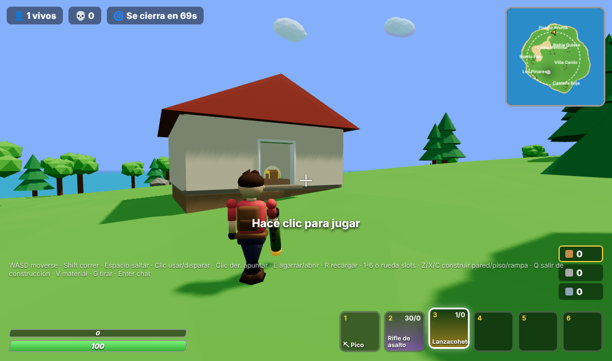

# Salto Final

Battle royale 3D para navegador: isla generada a partir de una semilla, bus volador, caída libre con planeador, tormenta que se achica y salas privadas a las que se entra con un código.

## Cómo jugar en tu compu

```bash
npm install
npm start
```

Abrí http://localhost:3000, poné tu nombre y tocá **Crear sala**. Tus amigos entran con el código de 5 letras (o con el link `http://TU-IP:3000/?sala=CODIGO` si están en tu misma red). Para jugar por internet hay que subir el servidor a un hosting con Node y WebSockets (Render, Railway, Fly.io, etc.).

## Mecánicas

- **Bus volador, caída libre y planeador.**
- **Loot** en el piso y en **cofres**, con cinco rarezas (común, poco común, rara, épica y legendaria) que suben el daño y bajan el tiempo de recarga.
- **Armas:** pistola, subfusil, rifle de asalto, escopeta, francotirador con mira y lanzacohetes con daño en área. Cada una usa su tipo de munición. Cada arma tiene su propio retroceso al disparar (sube, patea y se corre hacia atrás) y sus recargas animadas, revisadas para que el arma no atraviese el cuerpo.
- **Inventario** con 5 slots y el pico fijo.
- **Pico:** saca madera de los árboles, piedra de las rocas y metal de las paredes de las casas. Los árboles y las rocas se rompen.
- **Construcción:** paredes, pisos y rampas en una grilla de 4 m, en madera, piedra o metal, con vida propia. Se pueden romper a tiros o con el pico.
- **Escudo y curación:** vendas, botiquín, frasco azul y bidón azul.
- Al morir, el jugador tira todo lo que tenía. También hay daño por caída, tormenta por fases, números de daño, minimapa, killfeed, chat, modo espectador y sonidos sintetizados.

## Controles

| Tecla | Acción |
|---|---|
| WASD | Moverse |
| Shift | Correr |
| Espacio | Saltar del bus / abrir planeador / saltar |
| Clic izquierdo | Disparar, usar el pico, usar un consumible o construir |
| Clic derecho | Apuntar (con el francotirador, mira telescópica) |
| E | Agarrar objeto / abrir cofre |
| R | Recargar |
| 1 a 6 o rueda | Pico y slots |
| Z / X / C | Construir pared / piso / rampa |
| Q | Entrar y salir del modo construcción |
| V | Cambiar material |
| G | Tirar el objeto que tenés en la mano |
| Enter | Chat |

## Estructura

- `server.js`: servidor HTTP + WebSocket. Maneja salas por código, el recorrido del bus, la tormenta, la vida, el daño y quién gana.
- `public/js/world.js`: genera la isla (terreno, pueblos con casas, árboles, rocas, agua) de forma determinística a partir de la semilla de la sala, así todos ven el mismo mapa.
- `public/js/items.js`: armas, rarezas, munición, consumibles y materiales (lo usan el cliente y el servidor).
- `public/js/audio.js`: efectos de sonido sintetizados.
- `public/models/*.glb`: modelos 3D hechos en Blender (personaje, bus volador, planeador, armas y pico, casa, pino, árbol, roca, cofre y objetos del piso). El color de la ropa, las rarezas y las paredes se tiñe en el juego.
- `public/js/assets.js`: carga los GLB. Si alguno no carga, el juego usa los modelos procedurales de `models.js`.
- `public/js/models.js`: arma los personajes, el bus, el planeador, las armas y los objetos del piso a partir de los GLB. Si un GLB no carga, usa modelos low-poly hechos con primitivas como respaldo.
- `public/js/rig.js`: anima el personaje con su esqueleto (capas de piernas y torso, mezcla de locomoción, poses de armas, recargas, bombeo y retroceso por arma).
- `public/visor.html`: visor del personaje para revisar sus animaciones (`/visor.html`).
- `tools/blender/`: scripts de Blender que generan el personaje (`heroe_*.py`), las armas (`armas_*.py`) y sus animaciones. `recargas_control.py` y `armas_choque.py` revisan las animaciones sin renderizar (brazos, saltos entre cuadros y cuánto se mete el arma en el cuerpo). `tools/texturas/`: máscaras de la cara y el tatuaje.
- `Vault/`: vault de Obsidian que documenta el proyecto (empezar por `Vault/Inicio.md`) y grafo del código generado con graphify en `Vault/graphify-out`.
- `public/js/main.js`: el juego en sí (cámara en tercera persona, física, disparo, HUD, minimapa, red).

## Capturas



