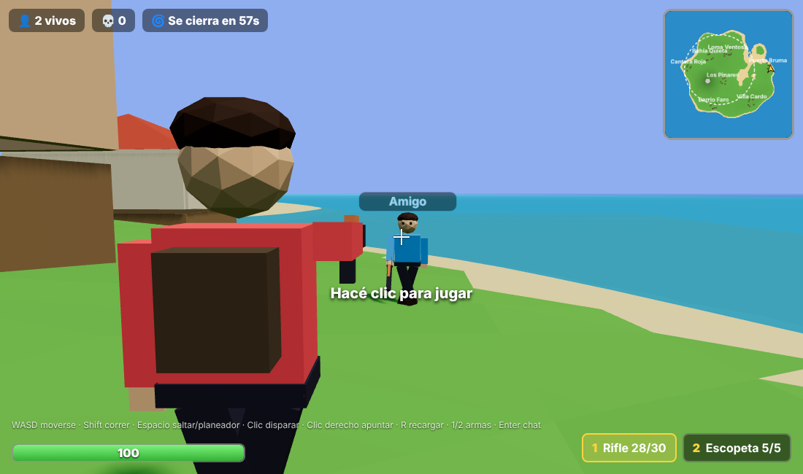

# Salto Final

Battle royale 3D para navegador: isla generada a partir de una semilla, bus volador, caída libre con planeador, tormenta que se achica y salas privadas a las que se entra con un código.

## Cómo jugar en tu compu

```bash
npm install
npm start
```

Abrí http://localhost:3000, poné tu nombre y tocá **Crear sala**. Tus amigos entran con el código de 5 letras (o con el link `http://TU-IP:3000/?sala=CODIGO` si están en tu misma red). Para jugar por internet hay que subir el servidor a un hosting con Node y WebSockets (Render, Railway, Fly.io, etc.).

## Controles

| Tecla | Acción |
|---|---|
| WASD | Moverse |
| Shift | Correr |
| Espacio | Saltar del bus / abrir planeador / saltar |
| Clic izquierdo | Disparar |
| Clic derecho | Apuntar |
| R | Recargar |
| 1 / 2 | Rifle / Escopeta |
| Enter | Chat |

## Estructura

- `server.js`: servidor HTTP + WebSocket. Maneja salas por código, el recorrido del bus, la tormenta, la vida, el daño y quién gana.
- `public/js/world.js`: genera la isla (terreno, pueblos con casas, árboles, rocas, agua) de forma determinística a partir de la semilla de la sala, así todos ven el mismo mapa.
- `public/js/models.js`: modelos del personaje, el bus volador y el planeador. Son provisorios, hechos con código, y la idea es reemplazarlos por modelos GLB hechos en Blender.
- `public/js/main.js`: el juego en sí (cámara en tercera persona, física, disparo, HUD, minimapa, red).

## Capturas



